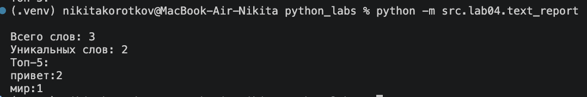
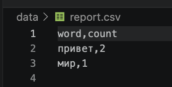
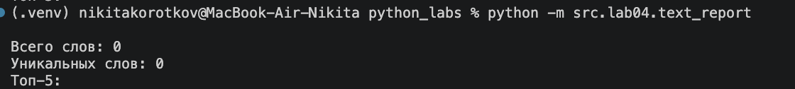
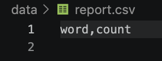
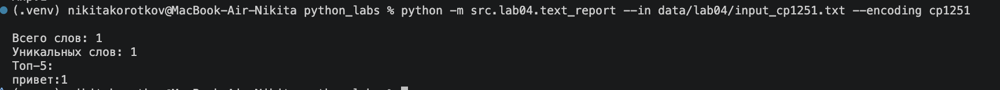
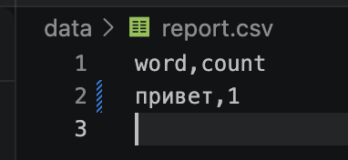
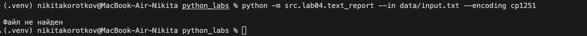

# Lab04 — Файлы: TXT/CSV и отчёты по текстовой статистике

## Файлы
- `src/lab04/io_txt_csv.py` — функции `read_text` и `write_csv`
- `src/lab04/text_report.py` — скрипт, который строит отчёт по частотам слов
- `src/lib/text.py` — `normalize`, `tokenize`, `top_n` из ЛР3
- `data/lab04/input.txt` — входной файл (UTF-8)
- `data/lab04/input_cp1251.txt` — входной файл в кодировке cp1251
- `data/lab04/report.csv` — отчёт

---

## Запуск
Все команды запускаются из корня проекта.

```bash
# читает data/lab04/input.txt, пишет data/lab04/report.csv
python -m src.lab04.text_report

# свой входной и выходной файл
python -m src.lab04.text_report --in data/lab04/input.txt --out data/lab04/out.csv

# файл в другой кодировке
python -m src.lab04.text_report --in data/lab04/input_cp1251.txt --encoding cp1251
```

| Параметр | По умолчанию | Описание |
|---|---|---|
| `--in` | `data/lab04/input.txt` | входной текстовый файл |
| `--out` | `data/lab04/report.csv` | куда сохранить отчёт |
| `--encoding` | `utf-8` | кодировка входного файла |

Отчёт `report.csv` имеет колонки `word,count` и отсортирован по `count` ↓, затем по `word` ↑.

---

## Кодировки
- По умолчанию входной файл читается в **UTF-8**.
- Если файл сохранён в другой кодировке, её передают через `--encoding`, например `--encoding cp1251`.
  В коде то же самое делается так: `read_text(path, encoding="cp1251")`.
- Если указать неверную кодировку, программа завершится с ошибкой `UnicodeDecodeError`.
- CSV-отчёт всегда записывается в **UTF-8**.

---

## Политика для краевых случаев
- **Пустой входной файл**: `report.csv` содержит **только заголовок** `word,count`, в консоли 0 слов и пустой Топ-5.
- **Входной файл не найден**: программа выводит `Файл не найден` и завершается, отчёт не создаётся.
- **Большой файл**: файл читается в память целиком (так требует ТЗ). В реальных задачах большие файлы лучше читать построчно.
- **`write_csv`**:
  - при пустом `rows` и `header=None` создаётся пустой файл;
  - при пустом `rows` и заданном `header` в файле будет только заголовок;
  - если строки в `rows` разной длины, функция поднимает `ValueError`.

---

## Тест-кейсы

### A. Один файл
Вход `data/lab04/input.txt`: `Привет, мир! Привет!!!`

```bash
python -m src.lab04.text_report
```

Терминал



CSV



---

### B. Пустой файл
Вход: пустой `data/lab04/input.txt`

```bash
python -m src.lab04.text_report
```

Терминал



CSV



---

### C. Кодировка cp1251
Вход `data/lab04/input_cp1251.txt` (cp1251): `Привет`

```bash
python -m src.lab04.text_report --in data/lab04/input_cp1251.txt --encoding cp1251
```

Терминал



CSV



---

### Файл не найден

```bash
python -m src.lab04.text_report --in data/lab04/nope.txt
```


