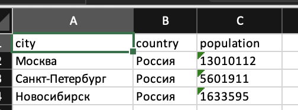
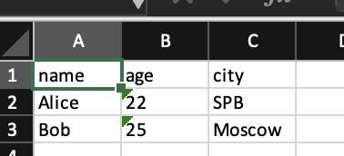

# Lab05 — JSON и конвертации (JSON<->CSV, CSV->XLSX)

## Файлы
- `src/lab05/json_csv.py` — функции `json_to_csv` и `csv_to_json`
- `src/lab05/csv_xlsx.py` — функция `csv_to_xlsx`
- `data/lab05/samples/` — входные файлы
- `data/lab05/out/` — результаты конвертаций
- `requirements.txt` — одна зависимость `openpyxl`

---

## Установка
Для CSV -> XLSX нужна библиотека `openpyxl`, она указана в `requirements.txt`.

```bash
pip install -r requirements.txt
```

---

## Запуск
Все команды запускаются из корня проекта.

```bash
# JSON -> CSV и CSV -> JSON
python -m src.lab05.json_csv

# CSV -> XLSX
python -m src.lab05.csv_xlsx
```

---

## Формат файлов
- Все файлы в UTF-8.

**JSON -> CSV**
- Колонки идут в порядке первого появления ключа: сначала ключи первого объекта, потом новые ключи из следующих.
- Если у объекта нет какого-то поля, в CSV будет пустая ячейка.

**CSV -> JSON**
- Каждая строка CSV становится словарём, ключи берутся из заголовка.
- Все значения сохраняются как строки (`"22"`, а не `22`).

**CSV -> XLSX**
- Лист называется `Sheet1`, первая строка — заголовок.
- Ширина колонки = длина самого длинного значения + 2, но не меньше 8.

---

## Тест-кейсы

### 1. JSON -> CSV
`data/lab05/samples/people.json` -> `data/lab05/out/people_from_json.csv`

```csv
name,age,city
Alice,22,SPB
Bob,25,Moscow
```

Заголовок `name,age,city`, было 2 объекта — стало 2 строки.

`data/lab05/samples/products.json` -> `data/lab05/out/products_from_json.csv`

```csv
name,price,category,color
Ноутбук,75000,Электроника,
"Мышь, беспроводная",1500,,
Стол,,Мебель,белый
```

У объектов разные поля, недостающие стали пустыми ячейками. Было 3 объекта — стало 3 строки.

---

### 2. CSV -> JSON
`data/lab05/samples/people.csv` -> `data/lab05/out/people_from_csv.json`

```json
[
  {
    "name": "Alice",
    "age": "22",
    "city": "SPB"
  },
  {
    "name": "Bob",
    "age": "25",
    "city": "Moscow"
  }
]
```

Ключи совпадают с заголовком CSV, было 2 строки — стало 2 объекта.

`data/lab05/samples/students.csv` -> `data/lab05/out/students_from_csv.json`

```json
[
  {
    "name": "Иванов Иван",
    "group": "БИВТ-25-1",
    "grade": "5"
  },
  {
    "name": "Петрова Анна",
    "group": "БИВТ-25-1",
    "grade": "4"
  },
  {
    "name": "Сидоров, Пётр",
    "group": "БИВТ-25-2",
    "grade": "3"
  }
]
```

Было 3 строки — стало 3 объекта, кириллица сохранилась.

---

### 3. CSV -> XLSX
`data/lab05/samples/cities.csv` -> `data/lab05/out/cities.xlsx`




`data/lab05/samples/people.csv` -> `data/lab05/out/people.xlsx`


