# Lab06 — CLI-утилиты с argparse

## Файлы
- `src/lab06/cli_text.py` — подкоманды `cat` и `stats`
- `src/lab06/cli_convert.py` — подкоманды `json2csv`, `csv2json`, `csv2xlsx`
- `src/lib/text.py` — функции `normalize`, `tokenize`, `count_freq`, `top_n` (используются в `stats`)
- `src/lab05/` — функции конвертации (используются в `cli_convert.py`)
- `data/lab06/samples/` — входные файлы
- `data/lab06/out/` — результаты конвертаций
- `images/lab06/` — скриншоты

---

## Запуск
Все команды запускаются из корня проекта, с активированным `.venv` (для `csv2xlsx` нужен `openpyxl`).

```bash
pip install -r requirements.txt
```


---

## cli_text.py

```bash
python -m src.lab06.cli_text --help
```
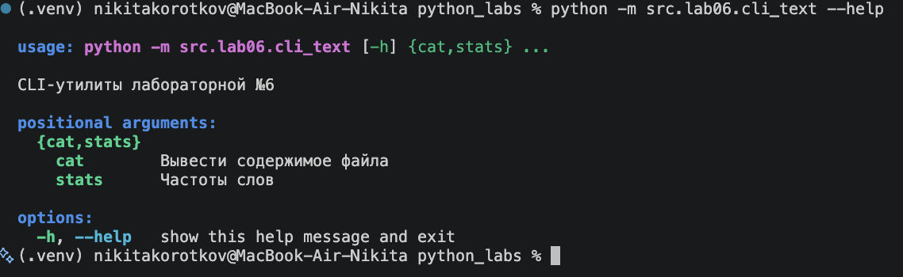

### cat — вывести файл построчно
| Параметр | Описание |
|---|---|
| `--input` | путь к файлу (обязательный) |
| `-n` | нумеровать строки |

```bash
python -m src.lab06.cli_text cat --help
python -m src.lab06.cli_text cat --input data/lab06/samples/people.csv -n
```
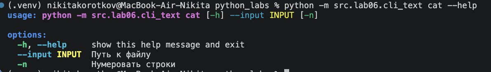
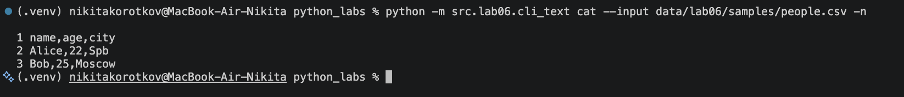

### stats — частоты слов
| Параметр | Описание |
|---|---|
| `--input` | путь к txt-файлу (обязательный) |
| `--top` | сколько слов выводить, по умолчанию 5 |

```bash
python -m src.lab06.cli_text stats --help
python -m src.lab06.cli_text stats --input data/lab06/samples/people.txt --top 5
```
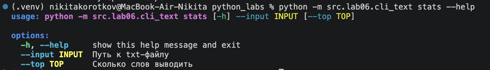
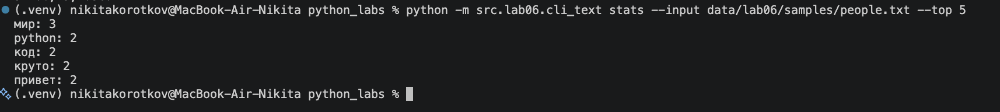

---

## cli_convert.py

```bash
python -m src.lab06.cli_convert --help
```
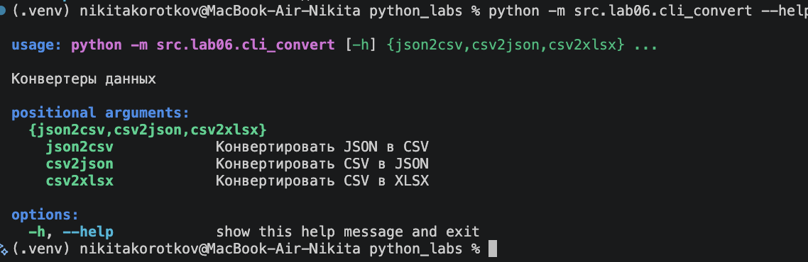

Все три подкоманды принимают одни и те же параметры:

| Параметр | Описание |
|---|---|
| `--in` | входной файл (обязательный) |
| `--out` | выходной файл (обязательный) |

```bash
python -m src.lab06.cli_convert json2csv --in data/lab06/samples/people.json --out data/lab06/out/people.csv
python -m src.lab06.cli_convert csv2json --in data/lab06/samples/people.csv --out data/lab06/out/people.json
python -m src.lab06.cli_convert csv2xlsx --in data/lab06/samples/people.csv --out data/lab06/out/people.xlsx
```

### json2csv
```bash
python -m src.lab06.cli_convert json2csv --help
```
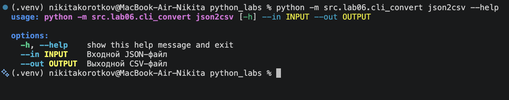

Результат — `data/lab06/out/people.csv`:

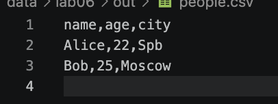

### csv2json
```bash
python -m src.lab06.cli_convert csv2json --help
```
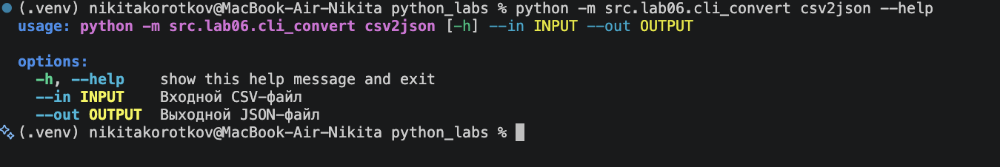

Результат — `data/lab06/out/people.json`:

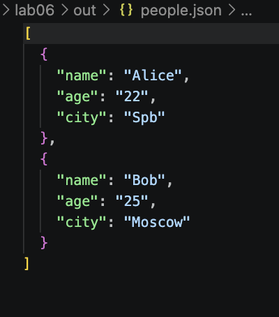

### csv2xlsx
```bash
python -m src.lab06.cli_convert csv2xlsx --help
```
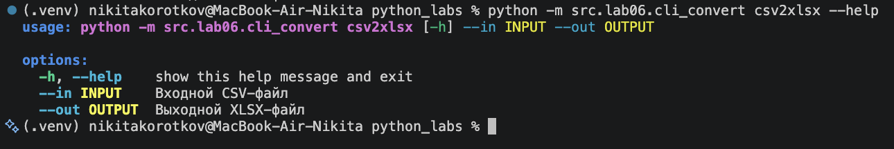

Результат — `data/lab06/out/people.xlsx`:

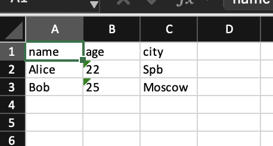

---

## Ошибки
- Входного файла нет — выводится `Файл не найден`.
- `--top` меньше или равен 0 — `parser.error`: `--top должен быть больше 0`.
- Нет обязательного аргумента или подкоманда неверная — ошибку и подсказку выводит `argparse`.
- Запуск без подкоманды — выводится справка.
