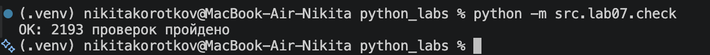
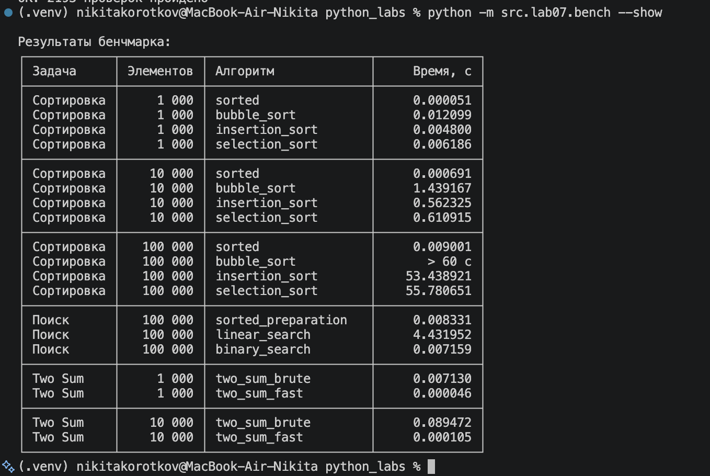

# Лабораторная работа №7

Поиск, сортировка и измерение времени.

---

## Задание A. Поиск (search.py)

| Функция | Как работает | Сложность |
|---|---|---|
| `linear_search` | Перебирает элементы, возвращает индекс первого вхождения или `-1` | O(n) |
| `binary_search` | Делит область поиска пополам, возвращает индекс или `-1` | O(log n) |
| `two_sum_brute` | Перебирает пары, возвращает индексы `(i, j)` или `None` | O(n²) |
| `two_sum_fast` | Ищет дополнение до суммы через словарь | O(n) в среднем |

Бинарный поиск работает на отсортированном списке. В Two Sum индексы разные и `i < j`.

## Задание B. Сортировки (sorting.py)

| Функция | Как работает | Сложность |
|---|---|---|
| `bubble_sort` | Меняет соседние элементы местами | O(n²) |
| `insertion_sort` | Вставляет число в отсортированную левую часть | O(n²), лучший случай O(n) |
| `selection_sort` | Находит минимум оставшейся части и ставит на нужное место | O(n²) |

Все сортировки возвращают новый список, исходный не меняют. Внутри не используются `sorted`, `.sort()`, `min` и `max`.

## Задание C. Проверка против эталона (check.py)

- `check_sorting` сравнивает результат с `sorted`, проверяет сохранность исходного списка.
- `check_search` проверяет поиск через `list.index`; для бинарного допускает любое вхождение.
- `check_two_sum` сравнивает ответы со всеми допустимыми парами индексов.

Используются по 100 случайных списков и дополнительные граничные случаи: пустые списки, один элемент, повторы, нули и отрицательные числа. При расхождении возникает `AssertionError` с данными.

Запуск из корня проекта с активированным `.venv`:

```bash
python -m src.lab07.check
```

Результат:

```text
OK: 2193 проверок пройдено
```



Счётчик учитывает проверенные вызовы алгоритмов, а не отдельные `assert`. Расхождений в итоговом прогоне нет.

## Задание D. Бенчмарк (bench.py)

- `bench_sorts` измеряет сортировки на 1 000, 10 000 и 100 000 элементов.
- `bench_search` выполняет 10 000 запросов к списку из 100 000 элементов; подготовительная сортировка измеряется отдельно.
- `bench_two_sum` сравнивает два решения на 1 000 и 10 000 элементов с гарантированной парой.
- `main` сохраняет CSV и выводит таблицу в терминал.

Замеры через `timeit`, один запуск. Используется `random.seed(42)`, данные для сравниваемых алгоритмов одинаковые. Свои сортировки ограничены 60 секундами через `signal` на macOS/Linux. Среда замеров: Python 3.14.6, macOS, arm64.

```bash
python -m src.lab07.bench
```

Показать сохранённую таблицу без повторных замеров:

```bash
python -m src.lab07.bench --show
```



Результаты сохранены в `data/lab07/bench.csv`, колонки: `task,n,impl,seconds`. Все времена ниже — в секундах.

### Сортировки

| Алгоритм | 1 000 | 10 000 | 100 000 |
|---|---:|---:|---:|
| `sorted` | 0.000051 | 0.000691 | 0.009001 |
| `bubble_sort` | 0.012099 | 1.439167 | > 60 с |
| `insertion_sort` | 0.004800 | 0.562325 | 53.438921 |
| `selection_sort` | 0.006186 | 0.610915 | 55.780651 |

### Поиск

Время всей серии из 10 000 одинаковых запросов. Все искомые числа существуют в списке.

| Операция | Время, с |
|---|---:|
| Подготовительная сортировка | 0.008331 |
| Линейный поиск | 4.431952 |
| Бинарный поиск | 0.007159 |

### Two Sum

| Алгоритм | 1 000 | 10 000 |
|---|---:|---:|
| `two_sum_brute` | 0.007130 | 0.089472 |
| `two_sum_fast` | 0.000046 | 0.000105 |

---

## Выводы

Пузырьковая сортировка имеет сложность O(n²), поэтому увеличение списка в 10 раз даёт примерно стократный рост времени. В замерах время выросло с 0.012099 до 1.439167 с — примерно в 119 раз. У `sorted` сложность O(n log n): ожидается рост примерно в 12–13 раз, в замерах получилось около 13.5 раза. На 100 000 элементов пузырёк превысил 60 секунд. Словарь в Two Sum оказался быстрее перебора пар; точное время зависит от расположения первой подходящей пары.

Бинарный поиск требует отсортированных данных, иначе нельзя правильно отбрасывать половину списка. При многократных запросах подготовка окупается: сортировка и 10 000 бинарных поисков вместе заняли 0.015490 с против 4.431952 с линейного поиска. Для одного запроса сортировать список обычно невыгодно. `check.py` выполнил 2 193 проверки без расхождений. При разработке исправлены границы бинарного поиска, сохранение `key` во вставках, обмен в сортировке выбором и запись значений в словарь Two Sum.
